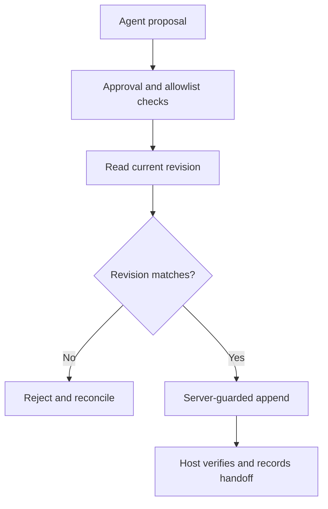

# Multi-Agent Harness

A small Python prototype for coordinating agents around shared documents without silently overwriting concurrent work.

The engineering focus is the boundary between a proposed action and a permitted write: explicit destinations, fresh revisions, approval checks, and verifiable results. All checked-in examples are synthetic. Personal deployments belong outside this repository.

## Run the offline demo

Requires Python 3.12; no packages, API keys, or network access are needed.

```sh
python examples/demo.py
python -m unittest discover -s tests -v
python scripts/check_public.py
```

The demo uses the real append adapter with an in-memory transport. It demonstrates an approved write, rejection of a stale proposal, and rejection of an unapproved proposal. It does not contact Google or run an LLM.

## Architecture



| Component | Implemented behavior |
| --- | --- |
| `src/drive_sync.py` | Allowlisted metadata reads and snapshot comparison |
| `src/guarded_docs.py` | Native Docs append with explicit tab and required revision |
| `src/governance.py` | Minimal action and revision helper functions |
| `schemas/` | Proposed event and edit formats; runtime validation is not wired in |
| `examples/demo.py` | Offline success and conflict demonstration |
| `scripts/check_public.py` | Heuristic checks on tracked working-tree files |

## Public code, private deployment

Keep reusable code, tests, and synthetic fixtures here. Keep real document IDs, agent assignments, schedules, journals, snapshots, and credentials in a separately controlled private location. The sample registry is illustrative and grants no permissions.

See [privacy boundaries](docs/PRIVACY.md), [connector-mediated workflow](docs/CHATGPT-MEDIATED-SYNC.md), and [optional API integration](docs/DRIVE-SYNC.md).

## Scope and limitations

This is a coordination prototype, not an autonomous orchestration platform or continuous two-way sync service. The host must authenticate agents, establish approval provenance, verify writes, and retain private audit records. Boolean approval flags are not an authorization service. Unit tests use a fake transport; they do not certify a production deployment.

Raw Markdown writes, Sheets transactions, durable approval queues, and automatic retries after uncertain writes are not implemented. The optional live workflow is manual and opt-in; the portfolio demo never needs credentials.

## Next milestones

- Bind approval to an exact proposal and authenticated actor.
- Add idempotency and explicit reconciliation for uncertain write outcomes.
- Validate schemas at runtime and add a private audit store.
- Exercise concurrency against a dedicated disposable integration-test document.
